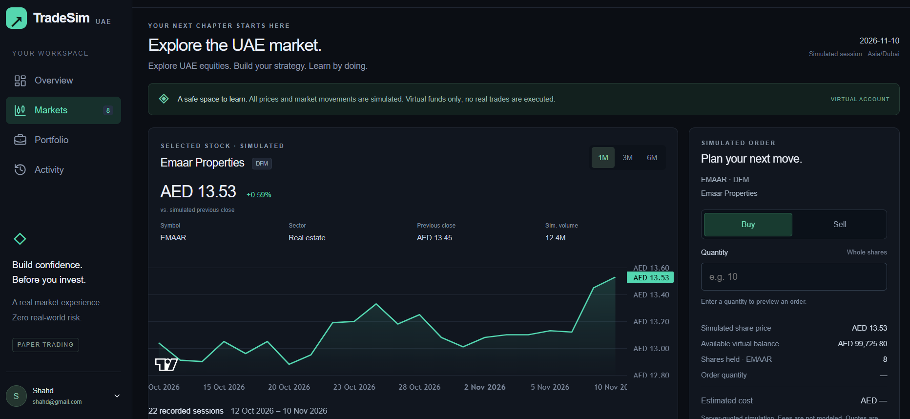
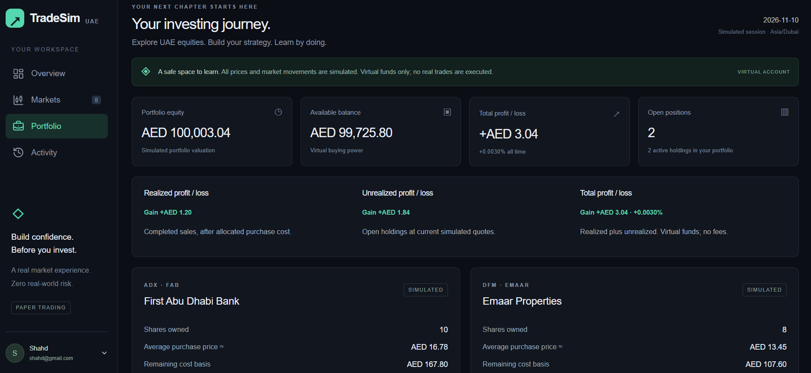

# TradeSim UAE

A full-stack paper-trading platform inspired by the Dubai Financial Market (DFM) and Abu Dhabi Securities Exchange (ADX). Explore fictional stock markets, practice buying and selling shares with virtual money, and track your portfolio in a responsive dashboard.

**[Live Demo](https://trade-sim-stock-trading-platform.vercel.app/)** · **[Source Code](https://github.com/Shahd-Saleem/TradeSim-stock-trading-platform)**

> **Simulation only:** All prices, price history, and trading volumes are fictional. TradeSim does not connect to a brokerage, execute real trades, or use live exchange data.

## Features

- **Virtual accounts:** Register or sign in and start with **AED 100,000** in virtual cash.
- **Markets:** Browse eight illustrative DFM/ADX stocks, search and filter listings, and explore interactive 1M, 3M, and 6M price charts.
- **Trading:** Buy and sell whole shares with order confirmation, balance and holdings checks, and persistent transaction records.
- **Dashboard:** See account equity, available cash, total profit/loss, open positions, and market highlights.
- **Portfolio:** Track share quantities, average purchase prices, cost basis, current valuations, and realized/unrealized profit and loss.
- **Activity:** Review your latest 100 completed trades.
- **Market updates:** Publish new simulated daily prices through a protected Vercel Cron Job, with catch-up and duplicate prevention. Open pages refresh quotes periodically.

## Application Pages

| Page | What it includes |
| --- | --- |
| **Home** (`/`) | Public introduction and links to explore markets or create an account. |
| **Markets** (`/markets`) | Stock search, exchange filters, price charts, and buy/sell controls for signed-in users. |
| **Dashboard** (`/dashboard`) | Personal account overview, cash, equity, returns, and market highlights. |
| **Portfolio** (`/portfolio`) | Holdings, cost basis, valuations, and profit/loss details. |
| **Activity** (`/activity`) | Recent completed buy and sell orders. |
| **Login / Register** | Email/password authentication and account creation. |

## Tech Stack

| Area | Technologies |
| --- | --- |
| Frontend | Next.js 16, React 19, TypeScript, CSS Modules |
| Backend | Next.js App Router and server-side API routes |
| Database | Supabase PostgreSQL, Prisma ORM 7 |
| Authentication | Better Auth |
| Charts and UI | TradingView Lightweight Charts, Lucide React |
| Validation | Zod |
| Testing | Vitest, Testing Library, PostgreSQL integration tests |
| Deployment | Vercel, Vercel Cron Jobs |

## How It Works

Each new account receives AED 100,000 in virtual funds. When a user places an order, the server verifies their session, reads the latest stored fictional quote, and checks available cash or shares. Trades execute inside PostgreSQL transactions with locking and idempotency safeguards to prevent inconsistent balances and duplicate orders.

Money is calculated in integer **fils** rather than floating-point AED amounts. Portfolio equity combines cash and current holdings value, while realized and unrealized profit/loss are calculated from trade history, remaining cost basis, and current simulated prices.

Fictional daily quotes are stored in PostgreSQL. A protected scheduled endpoint can publish the next eligible market session's prices; it skips weekends and configured closures. Historical stock charts show simulated **stock-price history**, not historical portfolio performance.

## Run Locally

### Prerequisites

- **Node.js 24.x** and npm
- A **Supabase PostgreSQL** project
- Database credentials with sufficient permissions for the initial setup

### 1. Clone and install

```bash
git clone https://github.com/Shahd-Saleem/TradeSim-stock-trading-platform.git
cd TradeSim-stock-trading-platform
npm ci
```

### 2. Configure the environment

Copy `.env.example` to `.env.local` and fill in your own values. The main settings include:

- `DATABASE_URL` — application database connection
- `DIRECT_URL` — administrative database connection for setup/migrations
- `BETTER_AUTH_SECRET` — authentication secret
- `BETTER_AUTH_URL` — local application origin, such as `http://localhost:3000`
- `DATABASE_CA_CERT_PATH` or `DATABASE_CA_CERT` — certificate configuration for verified TLS

Follow **[Database and Authentication Setup](docs/phase2.md)** for the required connection roles, TLS configuration, and credential setup. Never commit `.env.local` or real secrets.

### 3. Initialize the database

```bash
npm run auth:setup
npm run db:check
npm run db:migrate
npm run db:seed
npm run db:runtime
```

Optional: Populate approximately six months of simulated stock-price history for the charts:

```bash
npm run market:backfill
```

### 4. Start the development server

```bash
npm run dev
```

Visit **http://localhost:3000**. On Windows PowerShell, use `npm.cmd` if `npm.ps1` execution is blocked.

> Note: Automatic daily price updates require additional configuration. See the **[Automatic Market Updates](docs/phase4.2.md)**. You can run and test the application locally without enabling automatic updates.

## Testing

```bash
npm run typecheck
npm run lint
npm test
npm run build
```

The project also includes PostgreSQL integration tests for authentication, account isolation, order execution, concurrency, idempotency, and market publishing. Running them requires a separately configured test database; see the repository's setup documentation before using `npm run test:integration`.

## Deployment

Deployed using **Vercel** with **Supabase PostgreSQL**. See the **[Deployment Guide](docs/deployment.md)** for production setup and **[Automatic Market Updates](docs/phase4.2.md)** for the daily scheduler and restricted market-writer role.

---

## Screenshots

### Markets & Trading
Explore simulated UAE stocks, view historical price charts,
and execute virtual buy and sell orders.



### Dashboard
Monitor your virtual balance, portfolio equity, and market highlights.


### Portfolio
Track stock holdings, cost basis, valuations, and profit/loss.



---

Built as a full-stack software engineering portfolio project.
